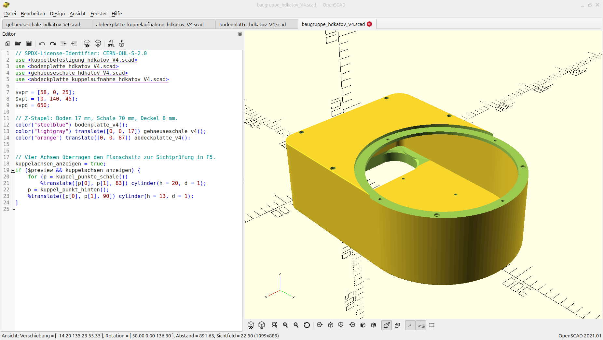

# ptz-outdoor-housing

> **ACHTUNG – Drucksperre HDKATOV V4 (Passprobe 25.11.2026)**
>
> Vor dem nächsten Druck sind beide Korrekturen zwingend umzusetzen und zu verifizieren:
> - [#32 – Hintere Kamerabohrungen korrigieren](https://github.com/richtertoralf/ptz-outdoor-housing/issues/32): Vordere M3-Achse Y=227 mm passt exakt, Kamera sitzt mittig. Beide hinteren Achsen von Y=154 mm voraussichtlich auf Y=146 mm zurücksetzen; Versatz nachmessen.
> - [#33 – Vertikalen Kuppelfreiraum erhöhen](https://github.com/richtertoralf/ptz-outdoor-housing/issues/33): etwa 3 mm, maximal 3 mm zusätzliche Höhe. Bevorzugt Abdeckplatte 8 → bis zu 11 mm, alternativ Schale 70 → bis zu 73 mm; tatsächlichen PTZ-Freiraum und Befestigungen prüfen.
>
> Bestehende V4-STL-Dateien nicht erneut zur Fertigung freigeben, bevor beide Korrekturen in CAD, betroffenen Schablonen und STL-Exporten nachvollziehbar umgesetzt und geprüft sind. Die praktische Abnahme bleibt erforderlich.

Offenes Hardwareprojekt für ein 3D-gedrucktes Wetterschutzgehäuse für
Indoor-PTZ-Kameras beim Sport-Livestreaming mit Stativ.

Der Entwurf ist noch nicht als wetterfestes, montierbares Gesamtsystem validiert.
Offene Konstruktionsfragen werden in den
[GitHub-Issues](https://github.com/richtertoralf/ptz-outdoor-housing/issues) verfolgt.

Die eigenen CAD-Dateien stehen unter **CERN-OHL-S-2.0**;
die Zuordnung erfolgt in [REUSE.toml](REUSE.toml).
Der vollständige [Lizenztext](LICENSE) stammt aus der
[offiziellen CERN-Veröffentlichung](https://cern-ohl.web.cern.ch/).
